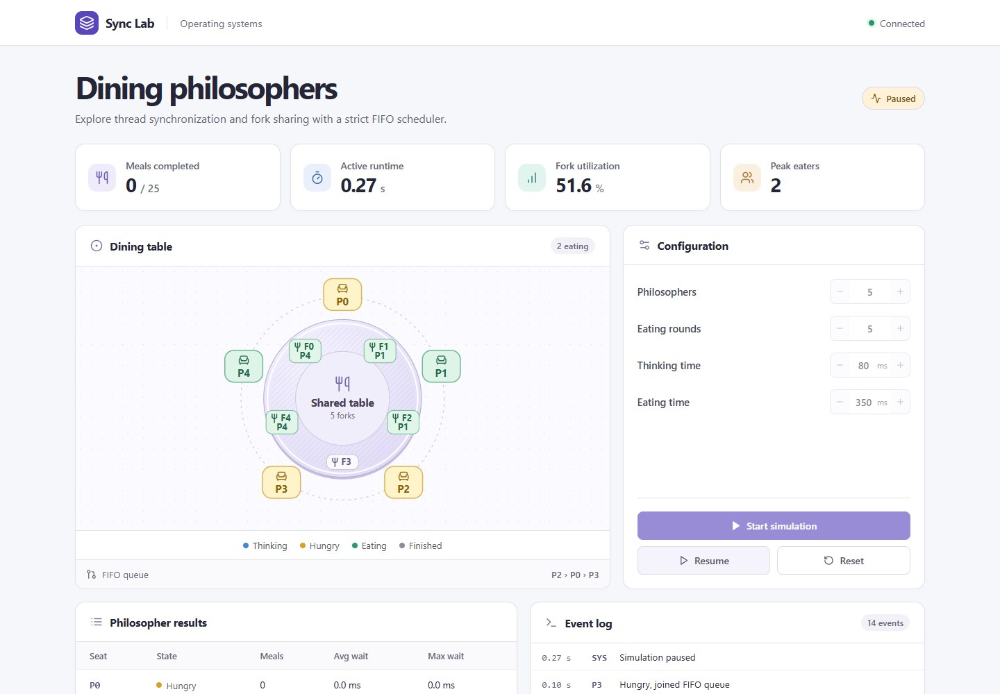
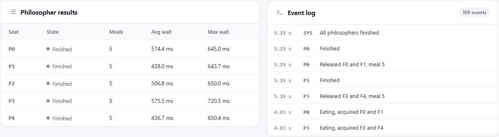
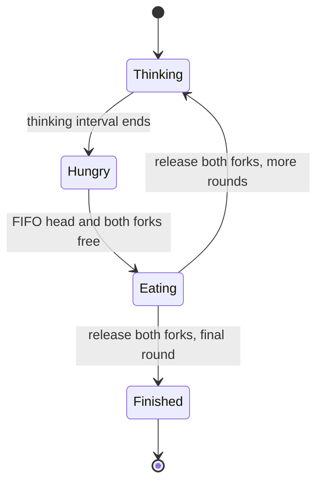
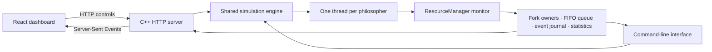
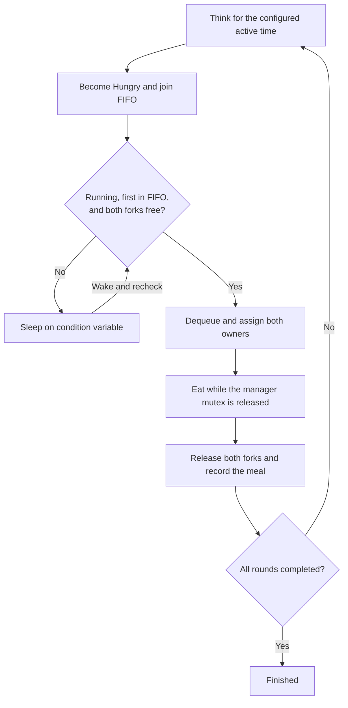

<div align="center">

# 🍽️ Dining Philosophers Simulator

### A deadlock-free, FIFO-scheduled concurrency lab powered by C++ threads and a live React dashboard

[](https://isocpp.org/)
[](https://react.dev/)
[](https://vite.dev/)
[](https://cmake.org/)

One shared C++17 simulation engine drives a timestamped command-line trace and a responsive browser interface. The project demonstrates mutex-protected resource allocation, condition-variable waiting, strict FIFO admission, concurrent eating by non-adjacent philosophers, and measured synchronization statistics.

[Preview](#preview) · [Quick start](#quick-start) · [How it works](#how-it-works) · [Testing](#testing) · [Viva questions](#viva-questions)

</div>

---

## Table of contents

- [Preview](#preview)
- [Features](#features)
- [Quick start](#quick-start)
- [How it works](#how-it-works)
- [Architecture](#architecture)
- [Algorithms and synchronization](#algorithms-and-synchronization)
- [CLI demo](#cli-demo)
- [Performance results](#performance-results)
- [Project structure](#project-structure)
- [Testing](#testing)
- [Limitations](#limitations)
- [Viva questions](#viva-questions)
- [Contributors](#contributors)

## Preview



The dashboard above is connected to the real C++ simulation. P1 and P4 hold disjoint fork pairs while later requests wait in FIFO order. Pause freezes the active clock and preserves the queue and fork owners for inspection.

<details>
<summary><strong>View completed results and the final event log</strong></summary>

<br>



</details>

## Features

| Capability | What it provides |
| --- | --- |
| Real C++ multithreading | One `std::thread` per philosopher, backed by the same engine in the CLI and website |
| FIFO resource scheduling | Hungry philosophers enter one strict first-in, first-out request queue |
| Atomic fork allocation | Both required forks are checked and assigned together under one mutex |
| Efficient waiting | `std::condition_variable` blocks workers without busy-waiting |
| Concurrent eating | Non-adjacent philosophers can eat at the same time when their fork pairs do not overlap |
| Live React visualization | Circular table, philosopher states, fork owners, queue position, controls, and timestamped events |
| Safe lifecycle controls | Start, Pause, Resume, and Reset use synchronized checkpoints and joined worker threads |
| Runtime statistics | Meals, average and maximum wait, active runtime, fork utilization, and peak simultaneous eaters |
| Standalone CLI | Configurable runs with synchronized logs and a per-philosopher summary |

## Quick start

### Prerequisites

- Windows 10 or 11
- [Git for Windows](https://git-scm.com/download/win)
- [MSYS2](https://www.msys2.org/) with the UCRT64 toolchain
- [Node.js 24](https://nodejs.org/) with npm
- Google Chrome or Microsoft Edge for the browser integration test

Open an **MSYS2 UCRT64** terminal once and install the compiler and build tools:

```bash
pacman -S --needed mingw-w64-ucrt-x86_64-gcc mingw-w64-ucrt-x86_64-cmake mingw-w64-ucrt-x86_64-ninja
```

Clone the repository, then build from PowerShell. Put the UCRT64 tools first on `PATH` in each new build terminal.

```powershell
git clone https://github.com/karthikbs01/dining-philosophers-simulator.git
Set-Location dining-philosophers-simulator

$env:Path = "C:\msys64\ucrt64\bin;$env:Path"
cmake -S . -B build -G Ninja -DCMAKE_CXX_COMPILER=g++ -DCMAKE_BUILD_TYPE=Release
cmake --build build
```

### Run the CLI

```powershell
.\build\dining.exe
# Or: .\build\dining.exe 5 3 40 25
```

### Run the website

Build the frontend, then start the C++ server from the repository root:

```powershell
Push-Location website\frontend
npm.cmd ci
npm.cmd run build
Pop-Location

.\build\dining_server.exe
```

Open **<http://127.0.0.1:8080/>**. Press `Ctrl+C` in the server terminal to stop it.

<details>
<summary><strong>CLI arguments, direct compilation, and frontend development</strong></summary>

### CLI arguments

```text
dining [philosophers [rounds [think_ms [eat_ms]]]]
```

| Argument | Default | Accepted whole numbers |
| --- | ---: | ---: |
| Philosophers | 5 | 2–10 |
| Rounds per philosopher | 3 | 1–100 |
| Thinking duration per round | 700 ms | 0–60000 ms |
| Eating duration per round | 450 ms | 0–60000 ms |

Zero is a valid phase duration. Invalid input prints usage information and returns a nonzero exit code.

The CLI can also be compiled directly with UCRT64 first on `PATH`:

```powershell
g++ -std=c++17 -O2 -pthread -static main.cpp philosopher.cpp resource_manager.cpp simulation.cpp -o dining.exe
.\dining.exe 5 3 40 25
```

For frontend development, keep the C++ server running on port `8080`, then start Vite in a second terminal:

```powershell
Set-Location website\frontend
npm.cmd run dev
```

Open **<http://127.0.0.1:5173/>**. Vite proxies `/api` to the C++ server. The backend accepts an optional port, such as `.\build\dining_server.exe 8081`, when serving a separate production build.

</details>

## How it works

For `N` philosophers, the table contains `N` forks. Philosopher `i` needs fork `i` and fork `(i + 1) % N`. Neighboring philosophers therefore share one fork and cannot eat together.

The classic deadlock appears when every philosopher holds one fork and waits for a second. This implementation never grants a partial set. A hungry philosopher joins a FIFO queue and sleeps until it is first in line **and** both forks are free. The resource manager then assigns both forks in one mutex-protected operation.



This removes hold-and-wait from hungry philosophers. Existing eaters already own everything needed to finish and release their pair. Later requests cannot overtake an enqueued request.

## Architecture



The CLI and web server link the same `engine` library. The browser sends lifecycle commands to the local C++ server and receives authoritative snapshots through Server-Sent Events. JavaScript displays the simulation; it does not implement a second scheduling algorithm.

<details>
<summary><strong>Local HTTP and event-stream reference</strong></summary>

| Method and path | Behavior |
| --- | --- |
| `GET /api/state` | Returns configuration, generation, status, philosopher results, fork owners, queue, statistics, and the event journal |
| `GET /api/events` | Streams state and newly recorded events using SSE |
| `POST /api/start` | Starts an idle or completed session with `count`, `rounds`, `thinkMs`, `eatMs`, and `generation` |
| `POST /api/pause` | Freezes the running session at synchronized checkpoints |
| `POST /api/resume` | Continues a paused session |
| `POST /api/reset` | Stops, wakes, joins, and replaces the current session with an idle one |

POST requests use URL-encoded fields, the current `generation`, and `X-Dining-Control: 1`. Success returns `204`, invalid input returns `400`, and stale or conflicting controls return `409`.

Each SSE connection begins with the current run's journal. Sequence numbers prevent duplicate events within a generation, and a generation change replaces stale browser state. The loopback server allows up to four live viewers.

</details>

## Algorithms and synchronization



| Mechanism | Role in the implementation |
| --- | --- |
| `std::mutex` | Protects philosopher states, queue order, fork owners, events, and measurements |
| `std::condition_variable` | Releases the mutex while workers wait for a phase deadline, a fork change, resume, or stop |
| Atomic pair grant | Checks availability and assigns both fork owners in the same critical section |
| FIFO queue | Prevents later hungry requests from overtaking earlier requests |
| `std::chrono::steady_clock` | Measures active elapsed time, waiting intervals, and fork occupancy without wall-clock adjustments |

<details>
<summary><strong>Deadlock freedom, starvation assumptions, and lifecycle synchronization</strong></summary>

### Deadlock freedom

A hungry philosopher holds no fork. An eating philosopher holds both forks and never asks for another resource before releasing them. The circular hold-and-wait pattern cannot form.

### Starvation freedom under documented assumptions

Once a philosopher enters the FIFO queue, later requests cannot pass it. Existing eaters complete in finite time, allowing the queue head to acquire its pair. Repeating this reasoning for each earlier request eventually brings every enqueued philosopher to the front. This argument assumes finite phase durations, eventual CPU scheduling of runnable threads, and eventual resumption of a paused run.

FIFO order starts at enqueue time. Thread launch order and philosopher number do not determine admission order, and FIFO fairness does not imply identical waiting times.

### Pause, resume, reset, and snapshots

Pause freezes the active clock while held forks and queue positions remain visible. Resume preserves the active time already spent in each phase. Reset marks the run stopped, clears ownership, wakes blocked workers, and joins every thread before installing a fresh idle session.

Snapshots copy the state and matching event sequence under the manager mutex. JSON serialization, network writes, and CLI printing happen after the lock is released.

</details>

<details>
<summary><strong>Statistics definitions</strong></summary>

| Metric | Calculation |
| --- | --- |
| Meals | Incremented after a complete eating phase releases both forks |
| Average wait | Sum of hungry-to-grant intervals divided by grants for that philosopher |
| Maximum wait | Longest hungry-to-grant interval for that philosopher |
| Active runtime | Monotonic elapsed time from start to final release, excluding pauses |
| Fork utilization | `100 × occupied fork-milliseconds / (N × active runtime in ms)` |
| Peak eaters | Highest simultaneous eater count observed at a grant |

A live utilization snapshot includes partial eating intervals. A pending request contributes to waiting statistics when it is granted. The UI receives snapshots roughly ten times per second during an active run, while the event journal retains every transition.

</details>

## CLI demo

The following excerpt comes from the checked-in [`sample_output.txt`](sample_output.txt), produced with five philosophers, three rounds, 40 ms thinking, and 25 ms eating:

```console
Dining Philosophers | strict FIFO | 5 philosophers | 3 rounds | think 40 ms | eat 25 ms
[0.00 ms] Simulation started
[44.48 ms] P0 Hungry, joined FIFO queue
[44.50 ms] P0 Eating, acquired F0 and F1
...
[345.13 ms] All philosophers finished

Philosopher   Meals   Avg wait (ms)   Max wait (ms)
P0               3           11.04           16.73
P1               3           33.72           68.27
P2               3           23.05           35.12
P3               3           11.10           16.60
P4               3           23.12           35.18
Total duration: 345.13 ms
Fork utilization: 57.75%
Maximum simultaneous eaters: 2
```

## Performance results

These are individual Windows measurements from five-round runs with 20 ms thinking and 20 ms eating. Thread scheduling and wake-up latency vary between executions, so the table is a recorded observation rather than a benchmark guarantee.

| Philosophers | Meals completed | Active runtime | Fork utilization | Peak eaters |
| ---: | ---: | ---: | ---: | ---: |
| 2 | 10 | 360.50 ms | 92.11% | 1 |
| 5 | 25 | 522.89 ms | 63.64% | 2 |
| 10 | 50 | 686.80 ms | 47.53% | 3 |

With two philosophers, every eater occupies every fork. A ten-philosopher table can physically support five eaters, while this recorded run reached three. Thinking intervals, operating-system scheduling, and strict FIFO head blocking can all leave forks idle.

## Project structure

```text
dining-philosophers-simulator/
├── main.cpp                       # CLI arguments, event trace, and summary
├── philosopher.h / .cpp           # Philosopher worker loop
├── resource_manager.h / .cpp      # Monitor, FIFO queue, forks, timing, and events
├── simulation.h / .cpp            # Worker startup, cancellation, and joins
├── CMakeLists.txt                  # Engine, CLI, server, tests, and TSAN option
├── sample_output.txt               # Recorded CLI run
├── docs/images/                    # Real dashboard screenshots used by this README
├── tests/
│   ├── engine_tests.cpp            # Synchronization and statistics audit
│   └── website.test.mjs            # Browser, API, SSE, and UI integration
└── website/
    ├── backend/
    │   ├── server.cpp              # Local HTTP/SSE session controller
    │   └── vendor/                 # cpp-httplib header and MIT license
    └── frontend/
        ├── package.json            # React, Vite, and browser test dependencies
        ├── vite.config.js           # Development server and API proxy
        └── src/                    # Dashboard components, state client, and CSS
```

## Testing

Run the engine suite from the repository root, then build and test the website:

```powershell
$env:Path = "C:\msys64\ucrt64\bin;$env:Path"
cmake --build build
ctest --test-dir build --output-on-failure

Push-Location website\frontend
npm.cmd ci
npm.cmd run build
npm.cmd test
Pop-Location
```

The browser suite starts an isolated C++ backend on a free port and closes it afterward. It uses Chrome by default. Set `$env:BROWSER_CHANNEL = "msedge"` to select Edge.

| Executed check | Verified result |
| --- | --- |
| 2, 5, and 10 philosophers × 3, 5, and 100 rounds | All nine configurations completed |
| Full event-journal replay | FIFO order, exclusive ownership, adjacency, meals, peak eaters, and timing calculations passed |
| Controlled non-adjacent grants | P0 and P2 held disjoint pairs simultaneously |
| Pause, resume, reset, and invalid inputs | Lifecycle and validation checks passed |
| Real browser → HTTP → C++ workers → SSE → React | Reconnect, pause/reload, resume, completion, reset, and concurrent Start checks passed |
| Displayed results versus backend snapshot | Fork owners, philosopher states, waits, and complete event sequence matched |
| Responsive layout | No horizontal overflow at a 360 px viewport |

The verified Windows environment used MSYS2 UCRT64 GCC 16.2.0, CMake 4.4.5, Ninja 1.13.2, Node.js 24.22.1, and npm 11.19.1. CTest applies a 90-second timeout to expose non-termination.

## Limitations

- **FIFO can reduce throughput.** If the queue head waits for a busy pair, a later request with two free forks cannot bypass it.
- **Fairness has assumptions.** Progress depends on finite phase durations, eventual CPU scheduling, and eventual resumption after Pause.
- **Timing is schedule-dependent.** Short requested intervals can be extended by wake-up latency and other host activity.
- **The server is local and single-session.** It binds to IPv4 loopback, supports one shared simulation, and limits live SSE viewers to four.
- **The current event journal is memory-resident.** Reset starts a new generation and discards the previous run from the active interface.
- **ThreadSanitizer is unverified on Windows.** The installed Windows compiler lacks `libtsan`.

<details>
<summary><strong>Run the optional ThreadSanitizer build on Linux</strong></summary>

```bash
cmake -S . -B build-tsan -DENABLE_TSAN=ON -DBUILD_WEBSITE=OFF -DCMAKE_BUILD_TYPE=Debug
cmake --build build-tsan
ctest --test-dir build-tsan --output-on-failure
```

This command is documented for a Linux GCC or Clang toolchain with a ThreadSanitizer runtime. No passing sanitizer result is claimed for this repository.

</details>

## Viva questions

<details>
<summary><strong>Why is one fork per philosopher sufficient?</strong></summary>

The forks form a ring, with one fork between each neighboring pair. Philosopher `i` uses fork `i` and fork `(i + 1) % N`.

</details>

<details>
<summary><strong>Why can adjacent philosophers never eat together?</strong></summary>

Their required fork pairs overlap at one index. Each owner-array entry stores only one philosopher, and a grant requires both entries to be free.

</details>

<details>
<summary><strong>Does one resource mutex serialize all eating?</strong></summary>

It serializes short ownership decisions. Once a pair is granted, the timed condition-variable wait releases the mutex. A non-adjacent FIFO head can then acquire another free pair and eat concurrently.

</details>

<details>
<summary><strong>Why recheck the predicate after a condition-variable notification?</strong></summary>

Another worker may change the shared state before this worker reacquires the mutex. Condition variables may also wake spuriously, so correctness must depend on the predicate rather than the notification alone.

</details>

<details>
<summary><strong>Does FIFO guarantee equal waiting times?</strong></summary>

No. FIFO prevents overtaking after enqueueing. The queue head may encounter occupied forks, so requests can still experience different finite waits.

</details>

<details>
<summary><strong>Why use a steady clock?</strong></summary>

Waiting and utilization require monotonic elapsed intervals. `std::chrono::steady_clock` is unaffected by wall-clock corrections.

</details>

<details>
<summary><strong>Where should a code walkthrough begin?</strong></summary>

Start with `dine()` in [`philosopher.cpp`](philosopher.cpp), then follow `request()`, `acquire()`, and `finishMeal()` in [`resource_manager.cpp`](resource_manager.cpp). Two grant events before either corresponding release demonstrate concurrent eating.

</details>

## Contributors

- **Karthik B Srinivas**
- **Ayush Aditya**

The backend bundles [cpp-httplib 0.67.0](https://github.com/yhirose/cpp-httplib/tree/v0.67.0). Its MIT license is preserved in [`website/backend/vendor/LICENSE`](website/backend/vendor/LICENSE). The repository does not currently declare a project-level license.
